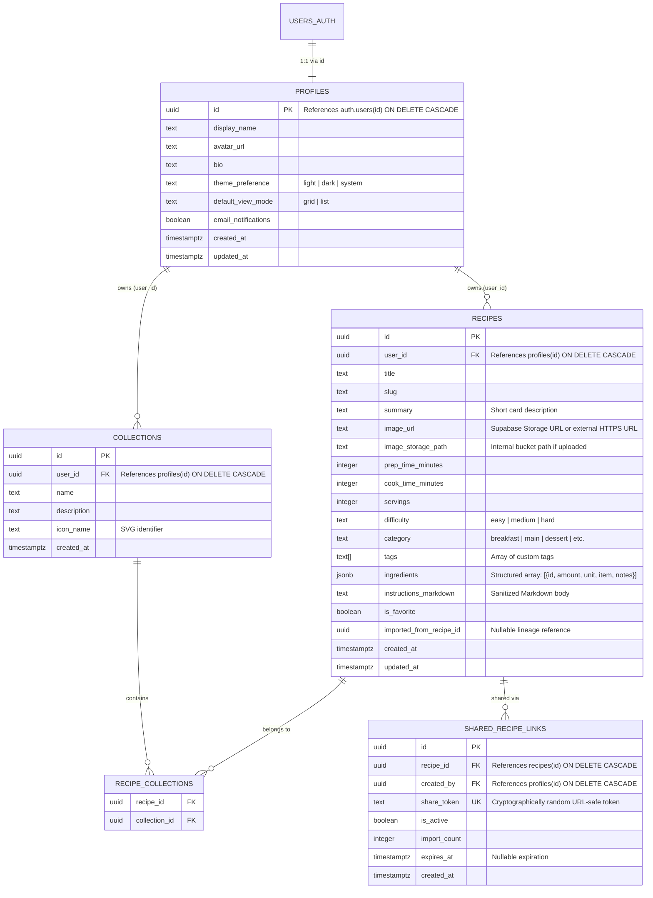

# Dishionary — Product Requirements Document (PRD)

> **Document Status:** Living Document (v1.1.0 — Phase 1 Complete)  
> **Last Updated:** 2026-11-03  
> **Target Branching Strategy:** `dev` (Feature Development & Integration) -> `main` (Production Deployment via Vercel CI/CD)

---

## 1. Executive Summary & Product Vision

**Dishionary** is a modern, production-grade digital cookbook web application designed for home cooks and culinary enthusiasts who want a distraction-free, structured, and visually warm space to curate, view, and exchange recipes.

Unlike cluttered recipe blogs, Dishionary prioritizes typographic clarity, speed, and ownership:

- **Complete Recipe Ownership:** Users build private, independent cookbooks with rich Markdown instructions, structured ingredient checklists, prep/cook times, tags, and high-resolution dish photography.
- **Seamless Reading Experience:** Users can browse their collection via responsive **Grid** or **List** card views, preview recipes in a **Quick View Drawer/Modal**, or open the **Full Cookbook Reader** featuring a conversation-style recipe sidebar for rapid switching between dishes while cooking.
- **Universal Recipe Portability:** Recipes can be exported as self-contained `.dishionary.json` bundles (including metadata, structured ingredients, Markdown instructions, and image references/fallbacks) or shared via tokenized read-only links that other Dishionary users can clone into their own cookbook in one click.
- **Tactile, Warm Aesthetics:** Built with a warm culinary color palette (terracotta, parchment cream, espresso, sage), custom SVG iconography (strictly zero emojis), and adaptive Light/Dark modes across mobile, tablet, and desktop viewports.

---

## 2. Technical Architecture & Stack Rationale

Every technology choice in Dishionary is selected to maximize type safety, security, developer velocity, and serverless scalability on the free/pro tiers of modern cloud infrastructure.

### 2.1 Core Stack Selection & Justification

| Layer                       | Technology                                                    | Why This Approach Was Chosen                                                                                                                                                                                                                                                                                 |
| :-------------------------- | :------------------------------------------------------------ | :----------------------------------------------------------------------------------------------------------------------------------------------------------------------------------------------------------------------------------------------------------------------------------------------------------- |
| **Framework**               | **Next.js (App Router, React 19, TypeScript 5)**              | Server Components (RSC) keep database queries and sensitive logic off the client bundle; Server Actions & Route Handlers provide type-safe mutations; built-in image optimization (`next/image`) handles recipe photography efficiently.                                                                     |
| **Database & ORM**          | **Supabase PostgreSQL + Drizzle ORM**                         | PostgreSQL provides relational integrity, JSONB support for structured ingredients, and full-text search. **Drizzle ORM** adds zero-overhead TypeScript schema definitions and versioned SQL migrations, while **Supabase Row-Level Security (RLS)** enforces tenant isolation at the database engine level. |
| **Authentication**          | **Supabase Auth (`@supabase/ssr`)**                           | Provides battle-tested Email/Password authentication (bcrypt/Argon2 hashing on backend, never exposed to client) and **Google OIDC** out of the box. Uses HTTP-only, secure cookies via Next.js middleware for seamless SSR session validation.                                                              |
| **Image Storage**           | **Supabase Storage**                                          | Stores recipe dish images and user avatars in dedicated buckets with RLS policies. Generates public/signed CDN URLs so exported recipes reference durable image URLs without bloating the PostgreSQL database with raw binary blobs.                                                                         |
| **Transactional Email**     | **Resend + React Email** (integrated with Supabase Auth SMTP) | Delivers high-deliverability verification emails, password reset links, and security alerts when account credentials or email addresses are updated.                                                                                                                                                         |
| **Styling & UI**            | **Tailwind CSS + shadcn/ui (Radix UI) + Lucide Icons**        | Enables a bespoke warm-toned CSS variable design system (`--background`, `--primary`, `--card`) with zero extreme gradients, accessible keyboard navigation, and crisp 1.5px stroke SVGs (no emojis).                                                                                                        |
| **Validation**              | **Zod + React Hook Form**                                     | Single source of truth for schema validation across client forms, Server Actions, and `.dishionary.json` import parsing.                                                                                                                                                                                     |
| **Markdown Engine**         | **`react-markdown` + `remark-gfm` + `rehype-sanitize`**       | Renders rich recipe instructions safely on the client/server while stripping any malicious XSS payloads (`<script>`, `onerror`, `javascript:` URIs).                                                                                                                                                         |
| **Testing**                 | **Vitest + React Testing Library + Playwright**               | Vitest provides sub-second unit testing for Zod schemas, Markdown sanitization, export/import serializers, and UI components.                                                                                                                                                                                |
| **Hosting & CI/CD**         | **Vercel + GitHub Actions**                                   | GitHub Actions runs lint, typecheck, and unit tests on every push/PR to `dev` and `main`. Vercel deploys `dev` to Preview URLs and `main` to the public production domain.                                                                                                                                   |
| **Logging & Observability** | **Pino (Structured JSON Logs) + Sentry + Vercel Analytics**   | Structured server logs redact PII automatically; Sentry captures unhandled runtime exceptions; deferred to Phase 7 so core product velocity stays high early on.                                                                                                                                             |

---

## 3. Design System & UI/UX Specifications

### 3.1 Color Palette (Warm Culinary Tone — No Extreme Gradients)

Dishionary uses solid surfaces, subtle 1px borders, and soft elevation shadows instead of neon or multi-stop gradients.

| Semantic Token       | Light Mode (Parchment & Terracotta)    | Dark Mode (Espresso & Warm Amber) | Usage                                            |
| :------------------- | :------------------------------------- | :-------------------------------- | :----------------------------------------------- |
| `--background`       | `#FAF7F2` (Warm Alabaster / Parchment) | `#161311` (Deep Roasted Espresso) | Primary page background                          |
| `--surface / --card` | `#FFFFFF` (Pure Warm White)            | `#211D1A` (Warm Charcoal Card)    | Recipe cards, modals, sidebar                    |
| `--surface-muted`    | `#F2ECE4` (Soft Oat)                   | `#2B2622` (Muted Cocoa)           | Secondary panels, input backgrounds, pill badges |
| `--foreground`       | `#1F1A17` (Deep Espresso Ink)          | `#F5EFEA` (Warm Cream Text)       | Headings and primary body copy                   |
| `--muted-foreground` | `#6E6259` (Warm Umber)                 | `#A89B91` (Muted Stone)           | Timestamps, secondary metadata, placeholders     |
| `--primary`          | `#C85A32` (Terracotta / Paprika)       | `#E07A5F` (Warm Terracotta)       | Primary CTA buttons, active states, focus rings  |
| `--secondary-accent` | `#4A6B53` (Culinary Sage Green)        | `#6B9075` (Soft Sage)             | Dietary badges, success states, prep time tags   |
| `--border`           | `#E6DEC3` / `#E5DDD3` (Warm Sand)      | `#332D29` (Dark Umber Border)     | 1px card dividers, input borders, sidebar split  |
| `--destructive`      | `#B93829` (Cayenne Red)                | `#E05344` (Soft Cayenne)          | Delete confirmations, validation errors          |

### 3.2 Typography & Iconography

- **Display / Recipe Titles:** Editorial Serif (`Newsreader` or `Playfair Display`) — evokes classic print cookbooks.
- **UI & Markdown Body:** Clean Humanist Sans (`Plus Jakarta Sans` or `Inter`) — high legibility at small sizes on mobile screens while cooking.
- **Monospace (Times, Quantities, Export JSON):** (`JetBrains Mono`) — tabular numerals for ingredient quantities and timers.
- **Iconography Rule:** **Strictly zero emojis** anywhere in the UI, empty states, or notifications. All icons use clean, consistent 1.75px stroke SVGs (via `lucide-react` and custom Dishionary SVG artwork).
- **Custom SVG Logo:** A bespoke geometric SVG mark combining an open cookbook spine and a chef's cloche/fork silhouette, adapting stroke/fill to Light and Dark themes via `currentColor`.

### 3.3 Responsive Viewport Breakpoints

- **Mobile (`< 640px`):** Single-column card stack; collapsible bottom sheet or slide-over drawer for the Cookbook Recipe Sidebar; sticky bottom action bar in recipe editor.
- **Tablet / Medium (`640px – 1024px`):** 2-column recipe grid; collapsible 260px recipe navigation sidebar; comfortable touch targets (`min-h-11`).
- **Desktop (`> 1024px`):** 3-to-4 column recipe grid or expansive table list view; persistent 300px conversation-style sidebar in the Cookbook Reader; split-pane or spacious Quick View drawer.

---

## 4. Database Schema Design



---

## 5. Application Sitemap & Page Architecture

1. **`/` — Public Landing Page:** Hero showcase with custom Dishionary SVG logo, interactive preview of a recipe card/reader, feature highlights (Markdown formatting, Quick View, Export/Import), and warm CTAs to Sign Up or Log In.
2. **`/login` & `/register` — Authentication Pages:** Email/password forms with inline validation, "Continue with Google" OIDC button, and links to password recovery.
3. **`/forgot-password`, `/reset-password`, `/verify-email` — Account Recovery & Verification Flows:** Clean status pages handling token verification and password updates with email notifications.
4. **`/dashboard` — User Home / Dashboard:**
   - Top search bar, category/tag pills, and **Grid / List View** toggle.
   - Quick stats bar (Total Recipes, Favorites, Collections, Quick Import button).
   - Recipe UI Cards displaying dish photography (as card header or subtle background treatment), title, estimated total cook time, category badge, and a **Quick View** trigger alongside a **Full Cookbook View** link.
5. **`/cookbook` & `/cookbook/[recipeId]` — My Cookbook (Conversation-Style Reader & Editor):**
   - **Left Sidebar (Conversation-style Navigator):** Searchable, scrollable list of the user's recipes grouped by Favorites, Recent, or Category/Collection. Clicking any item swaps the active recipe instantaneously without losing sidebar scroll position.
   - **Main Viewport (Scrollable Fullscreen Recipe Reader):** High-impact recipe hero image (or background header), prep/cook time badges, interactive ingredient checkboxes, and beautifully typeset Markdown instructions. Includes toolbar buttons to **Edit**, **Export (`.dishionary.json`)**, **Share Link**, **Toggle Fullscreen Reading Mode**, or **Delete**.
6. **`/cookbook/new` & `/cookbook/[recipeId]/edit` — Modern Recipe Form Editor:**
   - Structured inputs for Title, Summary, Prep/Cook Time, Servings, Category/Tags, Image Upload/URL, and dynamic Ingredient rows.
   - Clean Markdown editor with formatting toolbar and live preview tab for recipe instructions and chef notes.
7. **`/cookbook/import` & `/share/[token]` — Recipe Import & Shared Preview Pages:**
   - Upload a `.dishionary.json` file or inspect a shared recipe link before clicking **"Import to My Cookbook"**.
8. **`/settings` — Account & App Settings:**
   - **Profile & Security Tab:** Update display name, avatar, email address, or password (triggers verification/confirmation email). Connect/disconnect Google OIDC identity.
   - **Preferences Tab:** Toggle Light / Dark / System theme, default recipe view mode (Grid vs. List), and email notification preferences.
   - **Data Portability Tab:** Bulk export all recipes or delete account.
9. **`not-found.tsx` & `error.tsx` — Custom Error Boundaries:** On-brand SVG illustrations with recovery actions.

---

## 6. Phased Implementation Plan

> [!IMPORTANT]
> **Implementation Rule:** Each phase below is designed to be implemented, verified, and tested **one at a time**. We do not advance to Phase $N+1$ until Phase $N$ passes its verification criteria and `GEMINI.md` is updated.

---

### Phase 1: Project Foundation, Design System & CI/CD Pipeline (Completed)

**Status:** `[x] Complete`  
**Objective:** Scaffold the Next.js TypeScript project, configure the warm-toned Tailwind CSS design tokens, build the custom Dishionary SVG logo, set up Light/Dark mode switching, create the Landing Page and Error pages, and establish the GitHub Actions CI pipeline + Prettier + Vitest test runner.

#### Deliverables

1. [x] Next.js App Router initialization (`Next.js 16.4.4`) with TypeScript strict mode, ESLint v9, Prettier (`npm run format` / `npm run format:check`), and Tailwind CSS v4.
2. [x] Warm-toned CSS variables in `globals.css` supporting Light and Dark themes (`next-themes`), plus editorial serif, sans-serif, and monospace typography stacks.
3. [x] Custom SVG `<DishionaryLogo />` component and `<ThemeToggle />` SVG button (strictly zero emojis).
4. [x] Public Landing Page (`/`) and custom `not-found.tsx` / `error.tsx` boundaries.
5. [x] Vitest (`v5.1.0`) + React Testing Library setup with 8 passing unit tests covering core UI utilities, custom SVG brand component, and landing page guardrails.
6. [x] `.github/workflows/ci.yml` configured to run Prettier formatting checks, ESLint, TypeScript typechecking, Vitest unit tests, and production builds on `dev` and `main` branches.

#### Why This Approach Was Chosen

Establishing the design tokens, typography, testing harness, and CI pipeline in Phase 1 ensures every subsequent feature automatically inherits the warm visual identity and is gated by automated quality checks from day one.

---

### Phase 2: Database Schema, Supabase Auth, Google OIDC & Transactional Emails

**Objective:** Configure Supabase PostgreSQL with Drizzle ORM, enforce Row-Level Security (RLS), and implement secure user authentication (Email/Password + Google OIDC) with email verification and password reset flows.

#### Deliverables

1. Drizzle ORM configuration (`drizzle.config.ts`) and schema definitions (`profiles`, `recipes`, `collections`, `recipe_collections`, `shared_recipe_links`) + SQL migration scripts including RLS policies.
2. Supabase SSR client utilities (`lib/supabase/server.ts`, `lib/supabase/client.ts`, `middleware.ts`) protecting `/dashboard`, `/cookbook/*`, and `/settings`.
3. Authentication pages: `/login`, `/register`, `/forgot-password`, `/reset-password`, `/verify-email`, and `/auth/callback` (handling OIDC & email confirmation code exchange).
4. Transactional email notification templates and service helper (`lib/email/notifications.ts`) for account verification and security updates.
5. Unit tests for auth validation schemas (Zod) and route protection middleware logic.

#### Why This Approach Was Chosen

Using `@supabase/ssr` with Next.js Middleware stores session tokens in HTTP-only cookies rather than `localStorage`, eliminating client-side token theft while supporting both traditional Email/Password and Google OIDC under a unified `auth.users` identity.

---

### Phase 3: Recipe CRUD Engine, Image Storage & Hybrid Markdown Form

**Objective:** Build the end-to-end creation, reading, updating, and deletion of recipes, including Supabase Storage image uploads, structured ingredient management, and sanitized Markdown instructions.

#### Deliverables

1. Supabase Storage bucket configuration (`recipe-images`) with client-side image preview, file type/size validation (`<= 5MB`, WebP/PNG/JPEG), and upload helper returning durable public URLs (plus support for pasting external image URLs).
2. Zod validation schemas (`lib/validations/recipe.ts`) for recipe creation and editing.
3. Server Actions (`app/actions/recipes.ts`) enforcing authenticated ownership for Create, Update, Delete, and Favorite toggling.
4. Modern Hybrid Recipe Form (`/cookbook/new` and `/cookbook/[recipeId]/edit`):
   - Structured inputs for Title, Summary, Prep/Cook Time, Servings, Difficulty, Category, and Tags.
   - Dynamic drag/add/remove rows for Ingredients (`amount`, `unit`, `item`, `notes`).
   - Clean Markdown Editor with formatting toolbar (headings, bold, lists, callouts) and live sanitized preview (`react-markdown` + `remark-gfm` + `rehype-sanitize`).
5. Comprehensive unit tests for recipe Zod validation, Markdown XSS sanitization, and CRUD Server Action authorization checks.

#### Why This Approach Was Chosen

A hybrid form solves the biggest pain point of Markdown-only recipe apps: metadata and ingredients remain structured (enabling filtering, scaling, and interactive checkboxes), while cooking instructions retain the expressive flexibility of Markdown.

---

### Phase 4: User Dashboard, Grid/List Views, Filtering & Quick View Modal

**Objective:** Build the authenticated User Dashboard (`/dashboard`) featuring responsive Grid and List views, recipe cards with background/hero dish imagery, search and tag/collection filtering, and the scrollable Quick View drawer/modal.

#### Deliverables

1. Dashboard layout (`/dashboard`) with summary metrics, real-time search input, category/tag filter bar, and Collections selector.
2. `<RecipeCard />` component supporting two modes:
   - **Grid View:** Visual card with dish image (as rich card header or subtle darkened overlay background), cook time badge, favorite toggle, and hover elevation.
   - **List View:** Compact horizontal row optimized for scanning large cookbooks.
3. `<RecipeQuickView />` slide-over drawer / modal: opens directly from the Dashboard without a full page navigation, offering a scrollable view of the full recipe, interactive ingredient checkboxes, and a button to launch the Fullscreen Cookbook Reader.
4. Collections & Tags management modal to group recipes effortlessly.
5. Unit tests for recipe filtering/search logic and Grid/List card rendering.

#### Why This Approach Was Chosen

Providing both a Quick View modal on the dashboard and a dedicated Cookbook Reader satisfies two distinct user journeys: rapid scanning when meal-planning (Quick View) versus deep focus while actively cooking (`My Cookbook`).

---

### Phase 5: "My Cookbook" Conversation-Style Sidebar & Fullscreen Reader

**Objective:** Implement the signature `/cookbook` and `/cookbook/[recipeId]` experience where users navigate their recipes via a persistent, conversation-style left sidebar alongside a scrollable, distraction-free fullscreen recipe canvas.

#### Deliverables

1. Split-pane layout (`app/(app)/cookbook/layout.tsx`):
   - **Left Sidebar:** Searchable, filterable list of recipe items (thumbnail, title, cook time, category indicator) that behaves like a modern chat/conversation list, preserving scroll state across selections. Collapses into a smooth slide-over sheet on mobile screens.
   - **Right Canvas (`/cookbook/[recipeId]`):** Scrollable recipe view with hero dish photography, metadata pills, interactive ingredient checklist (with strikethrough state), and typeset Markdown instructions.
2. **True Fullscreen Cooking Mode Toggle:** Hides the app header and sidebar so the recipe fills 100% of the viewport for kitchen counter readability on tablets and phones.
3. Keyboard navigation shortcuts (`j`/`k` or arrow keys to cycle recipes, `f` for fullscreen, `/` to search sidebar).
4. Unit tests for sidebar navigation state and interactive ingredient checklist behavior.

#### Why This Approach Was Chosen

Modeling the cookbook view on Next.js nested layouts (`cookbook/layout.tsx` + `cookbook/[recipeId]/page.tsx`) means the sidebar stays mounted while only the recipe pane transitions—delivering instant, app-like navigation when switching between a main dish and a side dish.

---

### Phase 6: Recipe Portability (Export & Import via `.dishionary.json` & Share Links)

**Objective:** Enable users to export any recipe as a portable `.dishionary.json` bundle or generate a shareable public link so another user can preview and import the complete recipe (including image URL/data) into their own independent cookbook.

#### Deliverables

1. Standardized **Dishionary Recipe Exchange Format (`v1`)** schema:
   ```json
   {
     "schemaVersion": "1.0",
     "exportedAt": "2026-11-03T12:00:00Z",
     "sourceApp": "Dishionary",
     "recipe": {
       "title": "Braised Short Ribs",
       "summary": "Rich red wine braised beef short ribs.",
       "prepTimeMinutes": 25,
       "cookTimeMinutes": 180,
       "servings": 4,
       "difficulty": "medium",
       "category": "main",
       "tags": ["beef", "winter", "braise"],
       "imageUrl": "https://.../recipe-images/short-ribs.webp",
       "imageBase64Fallback": "data:image/webp;base64,...",
       "ingredients": [
         {
           "amount": "4",
           "unit": "lbs",
           "item": "bone-in beef short ribs",
           "notes": "trimmed"
         }
       ],
       "instructionsMarkdown": "## Searing the Ribs\n1. Pat dry and season generously..."
     }
   }
   ```
2. **File Export & Import (`/cookbook/import`):**
   - One-click download of `<slug>.dishionary.json` from any recipe.
   - Drag-and-drop `.dishionary.json` uploader with schema validation, live preview, image re-hosting/URL preservation, and import into the user's database.
3. **Shareable Link Flow (`/share/[token]`):**
   - Generate/revoke a unique read-only share link for a recipe.
   - Logged-in recipients can click **"Import to My Cookbook"** to clone the recipe metadata, Markdown, and image into their own account.
4. Unit tests for export serialization, import schema validation, malformed payload rejection, and recipe cloning logic.

#### Why This Approach Was Chosen

Supporting both a portable JSON file (with both `imageUrl` and optional embedded image fallback) and tokenized share links guarantees recipes can be backed up offline, sent over email/messaging apps, or shared via URL without breaking images or exposing private cookbooks.

---

### Phase 7: Account & App Settings, Observability & Production Hardening

**Objective:** Complete the Account & App Settings page (`/settings`), wire up email notifications for sensitive account updates, integrate structured logging and error reporting, and perform final responsive and accessibility polish.

#### Deliverables

1. `/settings` page with 3 sections:
   - **Profile & Account:** Update display name, avatar upload, email address update, and password change (with confirmation email trigger).
   - **Appearance & Defaults:** Theme switcher (Light / Dark / System), default dashboard view (Grid vs. List).
   - **Data & Privacy:** Bulk cookbook export (`.zip` or multi-recipe `.dishionary.json`) and account deletion with confirmation.
2. **Logging & Reporting Architecture (`lib/logger.ts`):**
   - Structured JSON logger (`pino`) with automatic redaction of tokens, passwords, and emails.
   - Error boundary telemetry hook ready for Sentry / Vercel Log Drains.
3. Comprehensive test suite verification, Lighthouse accessibility/performance audit, and production deployment verification on Vercel.

---

## 7. Logging & Reporting Strategy (Future-Ready Architecture)

To answer _"Logging & Reporting? How would that work?"_:

1. **Structured Server Logging (Pino):** Every Server Action and API Route logs structured JSON events (`level`, `timestamp`, `requestId`, `userId`, `action`, `durationMs`, `error`). Sensitive fields (`password`, `token`, `email`) are automatically redacted via Pino's censor paths.
2. **Error Tracking & Crash Reporting (Sentry):** Unhandled client exceptions (`error.tsx`, `global-error.tsx`) and server failures are captured with stack traces and breadcrumbs so issues in production are immediately actionable.
3. **Audit Events for Security Actions:** Login events, password changes, email updates, and public share link creations are logged with timestamps so users and administrators have a clear security trail.
4. **Zero-Cost Start, Seamless Scale:** In early phases, logs write to standard output (captured automatically by Vercel Logs). In Phase 7, a lightweight logger wrapper allows attaching Sentry or Axiom/BetterStack via environment variables without changing application code.
