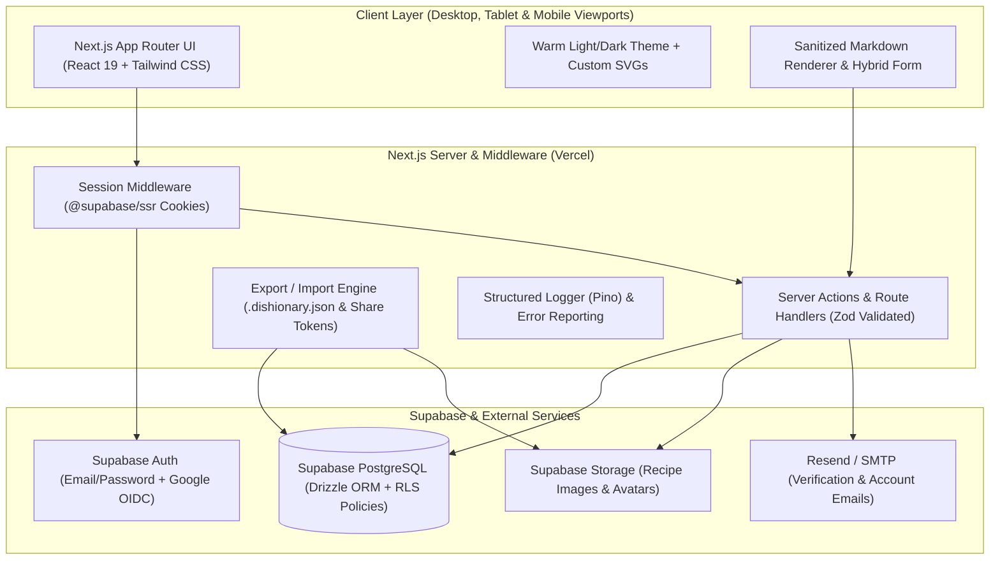
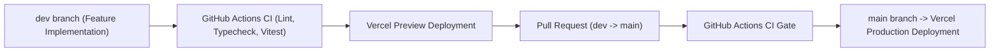

# Dishionary

**Your Modern, Private Digital Cookbook.**  
Curate, read, and exchange recipes with structured ingredients, clean Markdown instructions, and a warm culinary interface across desktop, tablet, and mobile.

---

## 1. Overview & Key Features

**Dishionary** is a full-stack cookbook web application built with **Next.js (App Router)**, **TypeScript**, **Supabase (PostgreSQL, Auth & Storage)**, **Drizzle ORM**, and **Tailwind CSS**.

- **Hybrid Recipe Authoring:** Edit recipe metadata, cook times, dish photography, and structured ingredient lists via intuitive form inputs while writing step-by-step instructions in sanitized **Markdown**.
- **Flexible Reading Modes:**
  - **Grid & List Dashboard Cards:** Browse your collection with dish photography, cook times, category tags, and favorites.
  - **Quick View Drawer:** Peek at any recipe in a scrollable overlay without leaving the dashboard.
  - **Conversation-Style Cookbook Reader (`/cookbook`):** Navigate between recipes effortlessly using a persistent left sidebar alongside a scrollable, distraction-free **Fullscreen Recipe View**.
- **Universal Recipe Export & Import:** Export any recipe as a self-contained `.dishionary.json` file or generate a shareable link (`/share/[token]`) so other users can import the recipe and its image directly into their own cookbook.
- **Secure Multi-Tenant Accounts:** Email/Password authentication and **Google OIDC**, backed by PostgreSQL Row-Level Security (RLS) and transactional email notifications for verification and account updates.
- **Warm Editorial Aesthetics:** Custom SVG logo and crisp SVG iconography (strictly zero emojis), a warm culinary color palette (terracotta, parchment, espresso, sage) with zero extreme gradients, and adaptive **Light / Dark mode**.

---

## 2. System Architecture



---

## 3. Repository Structure (Planned)

```text
dishionary/
├── .github/
│   └── workflows/
│       └── ci.yml                 # Lint, Typecheck & Vitest pipeline on dev & main
├── src/
│   ├── app/
│   │   ├── (public)/              # Landing page (/), Shared Recipe preview (/share/[token])
│   │   ├── (auth)/                # /login, /register, /forgot-password, /reset-password, /verify-email
│   │   ├── (app)/                 # Protected routes:
│   │   │   ├── dashboard/         # Grid & List recipe cards, filters, Quick View modal
│   │   │   ├── cookbook/          # Conversation-style sidebar + [recipeId] fullscreen reader, new, edit, import
│   │   │   └── settings/          # Account profile, security, theme & data export settings
│   │   ├── auth/callback/         # OIDC & Email verification code exchange route
│   │   ├── actions/               # Type-safe Server Actions (auth, recipes, collections, settings)
│   │   ├── error.tsx              # Custom error boundary
│   │   ├── not-found.tsx          # Custom 404 boundary
│   │   └── globals.css            # Warm color palette design tokens (Light & Dark)
│   ├── components/
│   │   ├── brand/                 # Custom Dishionary SVG logo & decorative SVGs
│   │   ├── cookbook/              # Sidebar navigator, RecipeCard, QuickViewModal, FullscreenReader, MarkdownEditor
│   │   ├── layout/                # Responsive header, mobile drawers, theme toggle
│   │   └── ui/                    # Reusable accessible primitives (buttons, inputs, dialogs, badges)
│   ├── db/
│   │   ├── index.ts               # Drizzle database client
│   │   ├── schema.ts              # PostgreSQL tables & relations
│   │   └── migrations/            # SQL migrations + RLS policies
│   └── lib/
│       ├── supabase/              # Server, Browser & Middleware Supabase SSR clients
│       ├── validations/           # Zod schemas (auth, recipe CRUD, .dishionary.json import/export)
│       ├── email/                 # Transactional email helpers
│       └── logger.ts              # Structured JSON logging utility
├── tests/                         # Vitest unit & component tests
├── GEMINI.md                      # Living AI project state & phase tracker
├── PRD.md                         # Product Requirements Document & phased roadmap
├── features.md                    # User stories & acceptance criteria
├── security.md                    # Authentication, RLS, XSS & privacy documentation
└── README.md                      # Setup, configuration & deployment guide
```

---

## 4. Environment Configuration

Create a `.env.local` file in the project root based on `.env.example`:

```bash
# Application URLs
NEXT_PUBLIC_APP_URL="http://localhost:3000"

# Supabase Public Configuration
NEXT_PUBLIC_SUPABASE_URL="https://<your-project-ref>.supabase.co"
NEXT_PUBLIC_SUPABASE_ANON_KEY="<your-supabase-anon-key>"

# Server-Only Database & Admin Secrets (Never expose to client)
DATABASE_URL="postgresql://postgres.<project-ref>:<password>@aws-0-us-east-1.pooler.supabase.com:6543/postgres"
SUPABASE_SERVICE_ROLE_KEY="<your-supabase-service-role-key>"

# Transactional Email (Resend)
RESEND_API_KEY="re_<your_resend_api_key>"
EMAIL_FROM="Dishionary <noreply@yourdomain.com>"
```

### Setting Up Google OIDC & Supabase

1. In the **Supabase Dashboard**, enable **Email** provider (with Confirm Email enabled) and **Google** provider under **Authentication -> Providers**.
2. In the **Google Cloud Console**, create an OAuth 2.0 Client ID and add your Supabase Callback URL (`https://<project-ref>.supabase.co/auth/v1/callback`) and local development callback (`http://localhost:3000/auth/callback`).
3. Create a public storage bucket named `recipe-images` in **Supabase Storage**.

---

## 5. Local Development & Testing

```bash
# 1. Install dependencies
npm install

# 2. Push or run database migrations (Drizzle ORM)
npm run db:push
# or generate/apply versioned migrations:
npm run db:migrate

# 3. Start the development server
npm run dev

# 4. Run unit tests (Vitest)
npm run test

# 5. Run linting, Prettier formatting, and TypeScript typechecking
npm run lint
npm run format
npm run format:check
npm run typecheck
```

---

## 5.1 Implementation Phase Status

- [x] **Phase 0: Architecture & Design Documentation** (`PRD.md`, `features.md`, `security.md`, `README.md`, `GEMINI.md`)
- [x] **Phase 1: Project Foundation, Design System & CI/CD Pipeline** (Next.js App Router, Tailwind CSS v4 warm theme, Custom SVG Logo, Landing Page, Prettier, ESLint, Vitest, GitHub Actions)
- [ ] **Phase 2: Database Schema, Supabase Auth, Google OIDC & Transactional Emails**
- [ ] **Phase 3: Recipe CRUD Engine, Image Storage & Hybrid Markdown Form**
- [ ] **Phase 4: User Dashboard, Grid/List Views, Filtering & Quick View Modal**
- [ ] **Phase 5: "My Cookbook" Conversation-Style Sidebar & Fullscreen Reader**
- [ ] **Phase 6: Recipe Portability (Export & Import via `.dishionary.json` & Share Links)**
- [ ] **Phase 7: Account & App Settings, Observability & Production Hardening**

---

## 6. Git Workflow & CI/CD Deployment (`dev` -> `main`)

Dishionary follows a strict two-branch production workflow integrated with **GitHub Actions** and **Vercel**:



1. **Feature Development (`dev` branch):** All phase implementations and feature commits happen on `dev` (or feature branches merged into `dev`). Pushing to `dev` triggers GitHub Actions CI and deploys a Vercel Preview environment.
2. **Production Release (`main` branch):** Once a phase is verified and all unit tests pass, `dev` is merged into `main` via Pull Request. Merging to `main` automatically deploys the public-facing production build on Vercel.

---

## 7. Documentation Index

- **[PRD.md](./PRD.md):** Product vision, tech stack justification, database ER diagram, color tokens, and the 7-phase implementation roadmap.
- **[features.md](./features.md):** Detailed user stories, acceptance criteria, and feature-to-phase traceability matrix.
- **[security.md](./security.md):** Authentication flows, Google OIDC, PostgreSQL RLS policies, Markdown XSS sanitization, and privacy safeguards.
- **[GEMINI.md](./GEMINI.md):** Continuous project state, architecture decisions, and active phase tracker.
