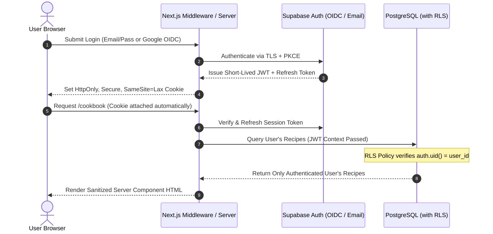

# Dishionary — Security, Authentication & Privacy Specification

> **Document Status:** Living Document (v1.2.0 — Phase 2 Complete)  
> **Last Updated:** 2026-11-03

---

## 1. Security Philosophy & Core Principles

Dishionary is designed around **Defense in Depth** and **Zero Trust** between the client browser, the Next.js server layer, and the PostgreSQL database:

1. **Zero Credentials in Frontend Storage:** Passwords, raw session tokens, and API secrets are **never** stored in `localStorage`, `sessionStorage`, or client-accessible state.
2. **Database-Enforced Multi-Tenancy:** Every user's cookbook is isolated not only by application-layer checks in Next.js Server Actions, but also by PostgreSQL **Row-Level Security (RLS)** policies enforced directly by the database engine.
3. **Strict Input Validation & Content Sanitization:** Every user-supplied payload—including Markdown recipe bodies, uploaded images, and imported `.dishionary.json` files—is validated via strict Zod schemas and sanitized against XSS before storage or rendering.

---

## 2. Authentication & Session Architecture

### 2.1 Email & Password Authentication

- **Password Hashing:** Handled exclusively server-side by Supabase Auth (GoTrue) using industry-standard **bcrypt / Argon2** with per-password cryptographic salts. Plaintext passwords are transmitted solely over TLS 1.3 (`HTTPS`) to the auth endpoint and are immediately discarded after hashing/verification.
- **Password Policy:** Enforced via Zod on both client and server:
  - Minimum 8 characters, maximum 128 characters.
  - Must contain at least one uppercase letter, one lowercase letter, and one digit or special character.
- **Email Verification:** New email/password accounts require email verification before accessing protected cookbook mutations, preventing account enumeration and spam signups.

### 2.2 Google OIDC (OpenID Connect) Integration

- **PKCE Flow (Proof Key for Code Exchange):** Dishionary uses the OAuth 2.0 / OIDC Authorization Code flow with PKCE via `@supabase/ssr`.
- **Callback Exchange (`/auth/callback`):**
  1. User clicks "Continue with Google" and authenticates with Google's OIDC provider.
  2. Google redirects to `/auth/callback?code=...`.
  3. The Next.js Server Route exchanges the temporary authorization code + PKCE verifier for a session on the server side and sets HTTP-only cookies.
- **Identity Linking:** Verified Google emails automatically link or provision a single unified user profile in `public.profiles`.

### 2.3 Secure Session Management (`@supabase/ssr`)

- **HTTP-Only Cookies:** Session JWTs (short-lived access token + rotating refresh token) are stored strictly in `HttpOnly`, `Secure`, `SameSite=Lax` cookies managed by Next.js Middleware (`middleware.ts`).
- **Automatic Token Refresh:** Next.js Middleware validates the session on every request and transparently refreshes expired access tokens on the server before rendering React Server Components.

---

## 3. Authorization & Data Isolation (Row-Level Security)

Every table in the `public` schema has PostgreSQL Row-Level Security (`ALTER TABLE ... ENABLE ROW LEVEL SECURITY;`) enabled from initial migration.

### 3.1 RLS Policy Matrix

| Table                     | Operation               | RLS Policy Rule                                                                    | Purpose                                                                                                                            |
| :------------------------ | :---------------------- | :--------------------------------------------------------------------------------- | :--------------------------------------------------------------------------------------------------------------------------------- |
| **`profiles`**            | `SELECT` / `UPDATE`     | `auth.uid() = id`                                                                  | Users can only view and update their own account profile and settings.                                                             |
| **`recipes`**             | `SELECT`                | `auth.uid() = user_id`                                                             | Users can only read recipes in their own private cookbook.                                                                         |
| **`recipes`**             | `INSERT`                | `auth.uid() = user_id`                                                             | Users can only create recipes assigned to their own `user_id`.                                                                     |
| **`recipes`**             | `UPDATE` / `DELETE`     | `auth.uid() = user_id`                                                             | Users can only modify or delete recipes they own.                                                                                  |
| **`collections`**         | `ALL`                   | `auth.uid() = user_id`                                                             | Collections are strictly private to the owning user.                                                                               |
| **`shared_recipe_links`** | `INSERT` / `DELETE`     | `auth.uid() = created_by`                                                          | Only the recipe owner can create or revoke a share link.                                                                           |
| **`shared_recipe_links`** | `SELECT` (Token Lookup) | Validated via controlled Server Action checking `share_token` & `is_active = true` | Allows a recipient with an unguessable token to preview & clone a single shared recipe without exposing the owner's other recipes. |

---

## 4. Application & Content Security

### 4.1 Markdown XSS Prevention

Because Dishionary renders recipe instructions via Markdown and allows users to import `.dishionary.json` files from other users, **untrusted Markdown is treated as a primary attack surface**.

- **No Raw HTML Execution:** `react-markdown` is configured **without** `rehype-raw`, or paired with strict `rehype-sanitize` allowlists.
- **Blocked Vectors:** `<script>`, `<iframe>`, `<object>`, `<embed>`, inline event handlers (`onerror`, `onload`, `onclick`), and `javascript:` / `data:text/html` links or image URLs are stripped before rendering.
- **Unit Tested:** Dedicated unit tests verify that malicious Markdown payloads (e.g., `[Click me](javascript:alert(1))` or ``) are neutralized.

### 4.2 Recipe Import (`.dishionary.json`) Validation

When a user imports a recipe file or clones via a share link:

1. **File Size Cap:** `.dishionary.json` files larger than `5 MB` are rejected immediately.
2. **Strict Schema Parsing:** The JSON payload is parsed through a strict Zod schema (`DishionaryExportSchema`) that strips unknown keys, enforces maximum string lengths (`title <= 160 chars`, `instructionsMarkdown <= 50,000 chars`, `ingredients <= 150 items`), and validates URL protocols (`https:` only).
3. **Ownership Reassignment:** Any `id` or `user_id` inside an imported file is ignored; a fresh UUID is generated and bound to the importing user's `auth.uid()`.

### 4.3 Image Upload & External URL Security

- **Supabase Storage Uploads:**
  - Bucket policy restricts uploads to authenticated users inside their own namespace (`recipe-images/{user_id}/{uuid}.{ext}`).
  - Allowed MIME types: `image/jpeg`, `image/png`, `image/webp`, `image/avif`. SVG uploads from users are disallowed in recipe photos to prevent embedded SVG script execution.
  - Maximum file size: `5 MB` per image.
- **External Image URLs:**
  - Must use `https://` protocol. Private IP ranges (`127.0.0.1`, `10.x.x.x`, `192.168.x.x`, `169.254.169.254`) are blocked by URL validation to prevent Server-Side Request Forgery (SSRF).

### 4.4 HTTP Security Headers (`next.config.ts`)

All responses from Dishionary include production security headers:

- `Content-Security-Policy` (CSP): Restricts script sources, image origins, and frame ancestors.
- `X-Content-Type-Options: nosniff`
- `X-Frame-Options: DENY`
- `Referrer-Policy: strict-origin-when-cross-origin`
- `Permissions-Policy: camera=(), microphone=(), geolocation=()`

---

## 5. Email Notifications & Account Verification Security

- **Account Verification:** Upon email/password registration, a single-use, time-limited verification link is emailed to the user.
- **Email Change Protection:** Updating an account email requires confirmation before the primary login address changes, and a notification is sent to the previous email address alerting the user of the request.
- **Password Change Notification:** Whenever a user updates their password in `/settings` or completes a `/reset-password` flow, an automated security email notifies the user that their credentials were changed.

---

## 6. Privacy, Data Portability & Secret Management

### 6.1 User Data Privacy & Right to Erasure

- **Independent Cookbooks:** No recipe is publicly searchable or visible to other users unless the owner explicitly exports a `.dishionary.json` file or generates a tokenized share link for that specific recipe.
- **Account Deletion (`CASCADE`):** When a user deletes their account in `/settings`, PostgreSQL `ON DELETE CASCADE` constraints and storage cleanup hooks permanently remove their profile, recipes, collections, share links, and uploaded images.

### 6.2 Environment Variables & CI/CD Secret Hygiene

- `.env.local` and `.env*.local` are strictly git-ignored.
- Only public connection identifiers (`NEXT_PUBLIC_SUPABASE_URL`, `NEXT_PUBLIC_SUPABASE_ANON_KEY`, `NEXT_PUBLIC_APP_URL`) are prefixed with `NEXT_PUBLIC_`.
- Privileged secrets (`SUPABASE_SERVICE_ROLE_KEY`, `DATABASE_URL`, `RESEND_API_KEY`) are restricted to server-only environments and stored in Vercel Encrypted Environment Variables and GitHub Actions Secrets.
